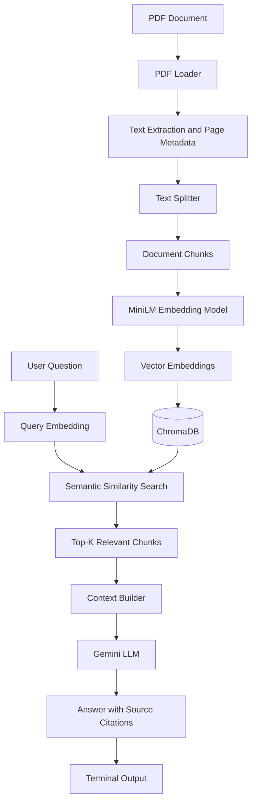

# Basic RAG Pipeline — Chat with Your PDF

A Retrieval-Augmented Generation (RAG) application that allows users to ask questions about PDF documents and receive context-aware answers grounded in the document's content.

The application extracts text from PDFs, splits it into smaller chunks, generates vector embeddings, retrieves relevant passages using semantic similarity, and uses Google's Gemini model to generate answers with source references.

## 1. Project Overview

Traditional LLMs can generate incorrect information or answer questions without referring to a specific document. This project addresses that problem by retrieving relevant information from a user's PDF before generating an answer.

### Key Features

- **PDF text extraction:** Extracts text page by page using `pypdf`.
- **Text chunking:** Splits extracted text into overlapping chunks for better retrieval.
- **Semantic embeddings:** Converts text into numerical vectors using Sentence Transformers.
- **Vector database:** Stores and retrieves document chunks using ChromaDB.
- **Semantic search:** Finds relevant passages based on the meaning of a query.
- **LLM-based generation:** Uses Google Gemini to generate answers from retrieved context.
- **Source citations:** Associates generated answers with retrieved source chunks.
- **Terminal interface:** Supports interactive question-answering directly from the command line.
- **Persistent storage:** Stores vector data locally using ChromaDB.

## 2. System Architecture



## 3. How the Pipeline Works

### Step 1: PDF Loading

The PDF loader reads the document using `pypdf` and extracts text from individual pages.

It preserves metadata such as the source PDF and page number so that retrieved passages can be traced back to the original document.

**Output:** Extracted page text with metadata.

### Step 2: Text Chunking

The extracted text is split into smaller chunks using LangChain's `RecursiveCharacterTextSplitter`.

Current configuration:

| Parameter | Value |
|---|---:|
| Chunk size | 1,000 characters |
| Chunk overlap | 200 characters |
| Splitting strategy | Recursive character splitting |

Chunk overlap helps preserve context when a relevant passage crosses a chunk boundary.

**Output:** Smaller text segments with page metadata and chunk indexes.

### Step 3: Embedding Generation

Each chunk is converted into a numerical vector using the Sentence Transformers model:

`sentence-transformers/all-MiniLM-L6-v2`

The same model is used to embed user questions, ensuring that document chunks and queries share the same vector space.

The model produces **384-dimensional embeddings**.

**Output:** Numerical vector representations of document chunks and user questions.

### Step 4: Vector Storage

ChromaDB stores the document chunks, their embeddings, and their associated metadata.

The collection is configured to use cosine distance for similarity-based retrieval. Persistent storage allows indexed vectors to remain available between application runs.

**Output:** Searchable document vectors and metadata.

### Step 5: Query Processing and Retrieval

When a user submits a question:

1. The question is converted into an embedding.
2. ChromaDB searches for semantically similar document chunks.
3. The nearest chunks are retrieved according to the configured top-K value.
4. A similarity threshold can be applied to filter less relevant results.

The pipeline uses cosine distance for ranking. Smaller cosine distances indicate more similar vectors.

**Output:** Relevant passages retrieved from the PDF.

### Step 6: Context Construction

The retrieved passages are assembled into a context block. Each passage receives a source identifier such as `[S1]`, `[S2]`, or `[S3]`.

These identifiers allow the answer-generation stage to associate citations with retrieved chunks.

**Output:** A structured context containing source IDs and text.

### Step 7: Answer Generation

The retrieved context and user's question are sent to Google's Gemini model.

The prompt instructs the model to answer using the supplied context, avoid unsupported claims, and cite the relevant source identifiers.

**Output:** A context-grounded answer with source citations.

### Step 8: Source Display

The application displays the generated answer in the terminal and can show source details such as the original page number and retrieved text.

This helps users inspect the passages used to produce an answer.

## 4. Technology Stack

| Technology | Purpose |
|---|---|
| Python | Core application logic |
| pypdf | PDF text extraction |
| LangChain | Text splitting and LLM integration |
| Sentence Transformers | Text and query embeddings |
| `all-MiniLM-L6-v2` | Embedding model |
| ChromaDB | Vector storage and retrieval |
| Google Gemini | Context-based answer generation |
| python-dotenv | Environment variable management |
| pytest | Automated testing |

## 5. Project Structure

```text
basic-rag-pipeline/
│
├── src/
│   ├── __init__.py
│   ├── pdf_loader.py
│   ├── text_splitter.py
│   ├── embeddings.py
│   ├── similarity.py
│   ├── vector_store.py
│   └── rag_chain.py
│
├── tests/
│   └── ...
│
├── chroma_db/
│   └── ...
│
├── app.py
├── requirements.txt
├── .env
├── .gitignore
└── README.md
```

*Note: This is the intended structure based on the current project modules. Keep only the files and directories that actually exist in your repository. The `chroma_db/` directory is generated by the application.*

### Responsibilities of the Main Modules

- `pdf_loader.py` — Loads PDF files, extracts page text, and handles PDF validation.
- `text_splitter.py` — Splits extracted text into manageable chunks.
- `embeddings.py` — Loads the embedding model and generates document/query embeddings.
- `similarity.py` — Provides cosine similarity calculations and validation.
- `vector_store.py` — Indexes chunks and retrieves relevant results from ChromaDB.
- `rag_chain.py` — Builds context, invokes Gemini, and manages answer citations.
- `app.py` — Streamlit interface, if retained in the project.

## 6. Installation and Setup

### Prerequisites

- Python 3.10 or later
- pip
- A Google Gemini API key

### Step 1: Clone the Repository

```bash
git clone https://github.com/Balli0596/Document_RAG
cd basic-rag-pipeline
```

Replace the repository URL and directory name with your actual GitHub repository details.

### Step 2: Create a Virtual Environment

On Windows:

```bash
python -m venv .venv
.venv\Scripts\activate
```

### Step 3: Install Dependencies

```bash
python -m pip install --upgrade pip
pip install -r requirements.txt
```

### Step 4: Configure Environment Variables

Create a `.env` file in the project root:

```env
GEMINI_API_KEY=your_gemini_api_key
GEMINI_MODEL=gemini-2.5-flash
```

Replace the placeholder with your actual API key. Use a model identifier supported by your configured Gemini API access.

**Security:** Never commit `.env` or expose your API key in source code.

### Step 5: Run the Application

Step 5: Run the Application

Place your PDF in the project directory or provide its path.

python -m streamlit run app.py --server.fileWatcherType none

The application should index the document and open an interactive terminal session for questions.

The application should index the document and open an interactive terminal session for questions.

Example questions:

```text
What is Agentic AI?
What are the applications of Agentic AI?
How is Agentic AI different from traditional AI?
What industries can benefit from Agentic AI?
```

Use the following command to inspect retrieved chunks when debugging:


## 7. Retrieval Configuration

The retrieval stage uses configurable parameters to control the number and relevance of the passages supplied to Gemini.

| Parameter | Current configuration |
|---|---:|
| Chunk size | 1,000 characters |
| Chunk overlap | 200 characters |
| Retrieval top-K | 15 in the current terminal debugging configuration |
| Maximum cosine distance | 0.45 by default in the RAG module; can be disabled for debugging |

Increasing top-K can improve coverage when the answer depends on multiple sections, but it can also introduce irrelevant passages and increase the prompt size.

A lower maximum cosine distance generally applies a stricter similarity filter. Retrieval quality should be evaluated on representative questions rather than relying on these values alone.

## 8. Error Handling and Limitations

### Current Considerations

- **PDF extraction:** Scanned PDFs that contain images rather than extractable text may require OCR.
- **Chunk boundaries:** Splitting text can separate definitions, examples, and headings.
- **Retrieval quality:** Table-of-contents pages, headings, and repeated text can rank above more useful passages.
- **Answer grounding:** Citations identify retrieved chunks, but matching a citation ID does not guarantee that the cited text fully supports the claim.
- **Context limits:** Retrieving too many chunks may increase latency or exceed the model's context limits.
- **API availability:** Gemini requests depend on API credentials, model availability, quotas, and network connectivity.
- **Indexing cost:** Rebuilding the index on every startup can unnecessarily repeat embedding work.
- **PDF structure:** Complex tables, columns, and scanned pages may not be extracted accurately.

### Possible Improvements

- Add a more robust front-matter and table-of-contents detector.
- Use a reranker to improve the ordering of retrieved chunks.
- Cache document embeddings and avoid unnecessary reindexing.
- Add automated retrieval evaluation using a set of test questions.
- Implement streaming responses and structured error handling.
- Support multiple documents and document-level filtering.
- Add OCR support for scanned PDFs.
- Evaluate citation correctness and answer faithfulness.

## 9. Testing

Run the automated tests with:

```bash
python -m pytest
```

For a focused test run:

```bash
python -m pytest tests/ -v
```

Test PDF validation, text extraction, chunking, embedding dimensions, retrieval behavior, and citation validation. Tests that call external APIs may require credentials and network access.

## 10. Key RAG Concepts Demonstrated

This project demonstrates the core components of a Retrieval-Augmented Generation system:

- Document ingestion and preprocessing
- Chunking and metadata management
- Dense vector embeddings
- Semantic similarity search
- Persistent vector databases
- Retrieval-augmented prompt construction
- LLM-based answer generation
- Source attribution and retrieval debugging

The central principle is that **the LLM receives retrieved document context before generating an answer**, rather than relying only on its pretrained knowledge.

## License

Add a license if you intend to distribute the project publicly. Until a license is selected, do not assume that others have permission to reuse or redistribute the code.
